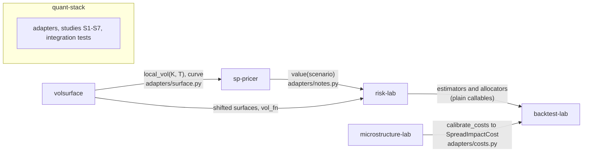
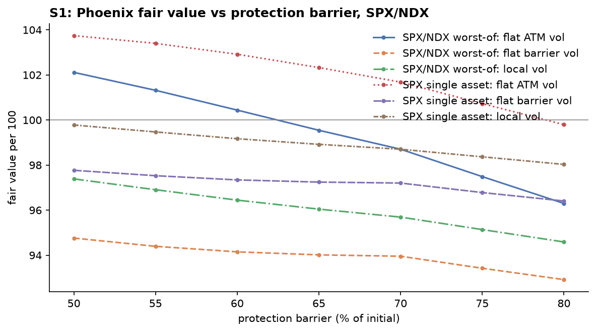
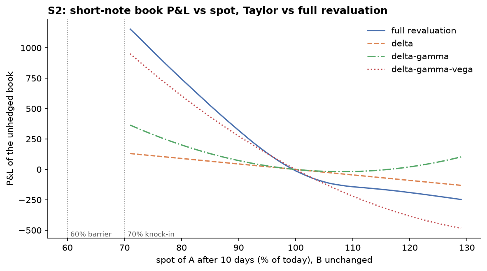
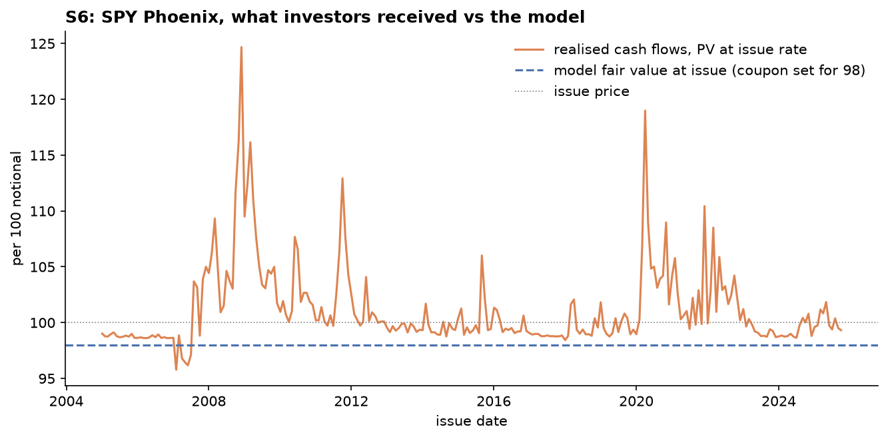
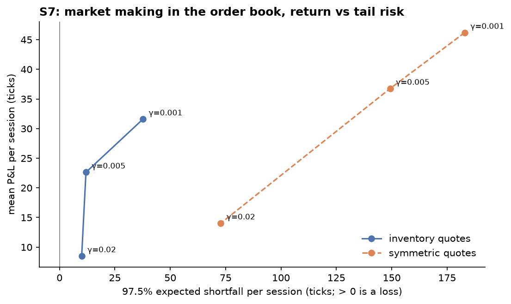

# quant-stack

> A connected quantitative finance research stack: structured product pricing, volatility
> surfaces, honest backtesting, market microstructure and risk, linked into end-to-end studies.

quant-stack holds five independent libraries as git submodules, pinned to tagged releases. It
connects them through small adapters and runs cross-project studies on top. No library imports
another, and none imports quant-stack. Each still installs, tests and releases on its own.

| Project | `pip install` (import) | What it does |
|---|---|---|
| [sp-pricer](https://github.com/hossainyousuf751/sp-pricer) | `sppricer` | Monte Carlo pricing of Phoenix autocallables and reverse convertibles, Greeks, barrier monitoring; Dupire local vol and term structure from v0.2 |
| [volsurface](https://github.com/hossainyousuf751/volsurface) | `volsurface-lab` (`volsurface`) | Arbitrage-free implied vol surfaces (SVI, SSVI, eSSVI, arbitrage-free SVI) from raw quotes, Dupire local vol, scenario shifts |
| [backtest-lab](https://github.com/hossainyousuf751/backtest-lab) | `btlab` | Backtesting with look-ahead tests, Deflated Sharpe, PBO, walk-forward, pluggable cost models, covariance strategies |
| [microstructure-lab](https://github.com/hossainyousuf751/microstructure-lab) | `lobkit` | Order-book reconstruction, order-flow imbalance, micro-price, Avellaneda–Stoikov; cost calibration and bars |
| [risk-lab](https://github.com/hossainyousuf751/risk-lab) | `marketrisk-lab` (`risklab`) | VaR/ES models and backtests, DCC-GARCH, shrinkage, HRP; scenario full-revaluation VaR and stress tests |

## How the pieces connect



Every arrow is a **protocol, not an import**. The library on the receiving end of an arrow defines a
small interface:

- sp-pricer's `LocalVolSource` is anything with `local_vol(K, T)` and a `curve`.
- risk-lab's `Position` is anything with `value(scenario)`.
- btlab's `CostModel` is anything with `cost(trade, date, context)`.

quant-stack wires real objects into those interfaces in [`src/quantstack/adapters/`](https://github.com/hossainyousuf751/quant-stack/tree/main/src/quantstack/adapters), and
nowhere else.

The libraries also duplicate a few small pieces on purpose instead of sharing a core package: three
Black-Scholes implementations and two yfinance loaders. [`tests/test_consistency.py`](https://github.com/hossainyousuf751/quant-stack/blob/main/tests/test_consistency.py)
asserts that the duplicates agree to 1e-12 on a grid of inputs and return the same data format.

## Studies

| Study | Question | Headline result |
|---|---|---|
| [S1](https://github.com/hossainyousuf751/quant-stack/blob/main/studies/s1_skew_autocallable.py) skew and the autocallable | What does pricing off the smile do to a Phoenix? | On the 2026-10-30 SPX/NDX close, local vol lowers the worst-of note from 100.44 to 96.44 per 100 (−4.00 ± 0.04 SE). The synthetic notes fall by 3.4 and 5.8 |
| [S2](https://github.com/hossainyousuf751/quant-stack/blob/main/studies/s2_note_book_risk.py) risk of a structured-note book | Where do linear VaR approximations break? | Delta-normal VaR of the delta-hedged book is 0, against 90 under full revaluation. Delta-gamma-vega overstates it at 152 |
| [S3](https://github.com/hossainyousuf751/quant-stack/blob/main/studies/s3_risk_portfolios_backtest.py) risk-based portfolios, honestly backtested | Do risk-lab's rankings survive costs, lag and selection? | Long-only minimum variance keeps the lowest true risk (9.5% vs 15.1% for 1/N) after lag and costs. Best of 24 configurations: Deflated Sharpe 0.94, walk-forward out-of-sample Sharpe 0.59. HRP's turnover barely falls with the window on synthetic data but falls 4× on real ETFs |
| [S4](https://github.com/hossainyousuf751/quant-stack/blob/main/studies/s4_costs_from_order_book.py) costs from the order book | Does a strong same-second order-flow relationship survive as a trade? | OFI (R² 0.59) loses after the spread alone. Queue imbalance survives spread, 1–5 s latency and the recorded book at small size, but covers at most 0.24 bp per unit traded, so any exchange taker fee kills it |
| [S5](https://github.com/hossainyousuf751/quant-stack/blob/main/studies/s5_skew_option_var.py) skew in option VaR | How much does the smile's behaviour under spot moves change option VaR? | Sticky moneyness more than doubles a short straddle's 1-day VaR against sticky strike (0.82 vs 0.38 synthetic, 0.84 vs 0.32 SPX) |
| [S6](https://github.com/hossainyousuf751/quant-stack/blob/main/studies/s6_autocallable_investors.py) how did autocallable investors do? | A SPY Phoenix issued monthly since 2005 at a model fair value of 98: what did investors actually receive? | Realised cash flows were worth 101.20 at the issue rate, +3.20 ± 0.72 (Newey-West) above the model. 94% autocalled, none lost capital, and the excess return over the 3-year rate was +1.1% ± 0.7% a year |
| [S7](https://github.com/hossainyousuf751/quant-stack/blob/main/studies/s7_market_maker_risk.py) market-maker inventory risk | How bad is a bad session for an Avellaneda–Stoikov quoter in the order book, and do standard VaR models know? | Symmetric quotes earn 46–65% more but carry 5–13× the 97.5% ES. Normal VaR fails 4 of 6 books (32–47 exceptions against 15), and RiskMetrics EWMA finds none on the inventory books because it assumes zero-mean P&L. Historical and FHS pass |

Each study prints its tables to [`docs/`](https://github.com/hossainyousuf751/quant-stack/tree/main/docs) (`s*_output.txt`, plus plots). All seeds are fixed.

### S1: skew and the autocallable



The note is sp-pricer's README note: 3 years, quarterly, a 2% memory coupon, autocall at 100% from
year 1, and 60% European protection. Every product here is short a down-and-in put, so the put skew
drives its value. Three models price the same note on the same forward curves and random numbers:

| SPX/NDX worst-of, ρ = 0.9 | Fair value | vs flat ATM | P(autocall at year 1) | P(knocked in) |
|---|---|---|---|---|
| flat ATM vol (18.2% / 23.8%) | 100.44 | | 47.0% | 7.7% |
| flat vol at the 60% strike | 94.15 | −6.29 ± 0.04 | 42.4% | 17.7% |
| Dupire local vol (arbitrage-free SVI) | **96.44** | **−4.00 ± 0.04** | 57.4% | 11.2% |

The local-vol pipeline is validated first, in [`tests/test_link_a.py`](https://github.com/hossainyousuf751/quant-stack/blob/main/tests/test_link_a.py). Monte
Carlo prices of 20 vanillas under sp-pricer's `LocalVolModel` imply back the volsurface surface's
own vols within 2.5 standard errors. Flat ATM vol misses the same targets by up to 940.

The S1 numbers also reproduce volsurface's earlier, independent simulator: 100.41, 96.14 and 96.42.
Halving or doubling the time step moves the worst-of note by no more than its standard error (96.23,
96.30 and 96.15, each ± 0.07).

### S2: risk of a structured-note book



A dealer is short four notes on two underlyings and may delta-hedge with shares. Each method gives a
10-day 99% VaR (lognormal scenarios, with implied vol falling 0.8 points per 1% rise in A):

| Book | Delta-normal | Delta-gamma-vega | Full revaluation (price grid) |
|---|---|---|---|
| unhedged | 89.9 | 222.4 | 154.4 |
| delta-hedged | **0.0** | 152.2 | **90.0** |

Full revaluation reprices every note in every scenario. To make 20,000 scenarios affordable, it
interpolates on a price grid validated against direct repricing at random points: the mean error is
0.02 per 100 and the largest is 2.2 Monte Carlo standard errors.
The same pattern holds under fat-tailed DCC-t scenarios.

### S5: skew in option VaR

risk-lab Study 3's books, priced off a fitted smile instead of one flat vol, with full revaluation only:

| 1-day 99% VaR | flat ATM | sticky strike | sticky moneyness |
|---|---|---|---|
| covered call | 1.97 | 2.05 | 1.92 |
| protective put | 1.86 | 1.83 | 2.04 |
| short ATM straddle | 0.38 | 0.38 | **0.82** |

(Synthetic SSVI surface; the SPX snapshot gives the same ordering.)

### S6: how did autocallable investors actually do?



A 3-year SPY Phoenix is issued on the first trading day of every month from 2005 to 2025: quarterly
observations, a memory coupon above 70%, autocall at 100% from year 1, and 60% European protection.
The coupon is set at issue, from that day's VIX and Treasury yields only, so that sp-pricer's fair value
is 98 (a 2-point margin). The realised SPY path, from btlab's loader, then gives each note's actual cash
flows, read off by the product's own payoff code.

| 250 notes, 2005-01 to 2025-10 | Value |
|---|---|
| coupon set at issue, per year | mean 3.23%, from −0.32% (2013) to 28.4% (Nov 2008) |
| model fair value at issue | 98.00 |
| realised cash flows, PV at the issue rate | **101.20** (+3.20 ± 0.72) |
| realised IRR minus the 3-year rate | +1.13% ± 0.69% a year |
| outcomes | 94% autocalled (83% at year 1), 6% repaid at par, 0 losses |
| VIX at issue vs realised vol over the note's life | 19.3% vs 17.0% |

VIX stands in for a 3-year ATM vol, with no skew or term structure. The note is on SPY total return with
zero dividend yield, and the rate carries no issuer funding spread. The 21 years of overlapping notes hold
only about seven independent 3-year windows.

### S7: market-maker inventory risk



microstructure-lab's Avellaneda–Stoikov quoter runs inside its order-book simulator for 2,500 independent
5-minute sessions per setting. It uses the paper's inputs calibrated on the book, as in that repo's Study 4.
risk-lab measures each P&L series and backtests its four VaR models over the last 1,500 sessions.

| Session P&L (ticks) | Mean | Skew | Excess kurtosis | P(loss) | 99% VaR | 97.5% ES | Mean / ES |
|---|---|---|---|---|---|---|---|
| γ = 0.001, inventory | 31.6 | −0.57 | 0.8 | 9.9% | 37.0 | 37.7 | 0.84 |
| γ = 0.001, symmetric | 46.2 | −1.29 | 6.3 | 16.7% | 169.0 | 182.9 | 0.25 |
| **γ = 0.005, inventory** | **22.6** | −0.25 | 0.6 | **4.3%** | **10.0** | **11.9** | **1.90** |
| γ = 0.005, symmetric | 36.8 | −1.03 | 4.9 | 17.8% | 143.0 | 149.3 | 0.25 |
| γ = 0.02, inventory | 8.5 | −0.27 | 0.5 | 10.1% | 10.5 | 10.0 | 0.85 |
| γ = 0.02, symmetric | 14.0 | −1.00 | 5.9 | 21.6% | 70.0 | 72.8 | 0.19 |

| 99% VaR backtest, 6 books | Kupiec passes (p > 0.05) | Exceptions (15 expected) | 97.5% ES (Z2) |
|---|---|---|---|
| historical, 500 sessions | 6 of 6 | 13–21 | passes everywhere |
| filtered historical (FHS), 1,000 | 5 of 6 | 11–24 | passes everywhere |
| normal, 500 | 2 of 6, both at p = 0.054 | 23–47 | rejected on 4 books (−0.96 to −1.35) |
| EWMA (RiskMetrics) | 3 of 6: symmetric books only | 0 on every inventory book | far too conservative on inventory books |

In the paper's own fill model, not one of 2,500 sessions loses money (the worst is +43), so a loss VaR
there is meaningless. Losses come from the order book's queue position and adverse selection.

## What was surprising, what went wrong, and how it was diagnosed

**S1: a "skew-aware" flat vol overshoots.** Pricing the note with flat vol taken at the barrier
strike sounds like a cheap way to respect the skew, so I expected it to land near local vol. It lands
well below it instead: −6.3 against −4.0 on SPX/NDX, and −8.1 against −5.8 on the synthetic worst-of.
The autocall probabilities show why. A barrier-strike vol applies put-wing volatility everywhere,
including near and above 100%, where local vol is low. So it understates the chance of an early
call at year 1 (42% vs 57%) and overstates the chance of ending knocked in (18% vs 11%). Local vol
is not "flat vol at the right strike"; it is a different vol in each region the path visits. The
local-vol pipeline was validated before any of this: Monte Carlo vanillas reprice the surface within
2.5 SE, and two independent simulators agree within error.

**S2: delta-gamma-vega was worse than delta-normal, in the other direction.** I expected the
second-order expansion to land between delta-normal and full revaluation. Instead it overstates the
unhedged book's VaR by 44% (222 vs 154). To find out why, I repriced each note under parallel vol
shifts. The notes' value is concave in vol: an 8-point fall in vol raises the single-asset Phoenix by
3.8 per 100, while vega × shift says 4.9. The scenarios move vol against spot (−0.8 points per 1%),
so the 10-day tail combines a rally with a large vol fall, exactly where linear vega overstates the
dealer's loss. Delta-normal misses the other way: it reports zero risk for the delta-hedged book,
which full revaluation puts at 90. Getting the full-revaluation number cheaply also took a second
attempt. The first price grid missed direct repricing by up to 5.5 SE. That pointed at the vol axis
rather than the spot axis, because tightening the spot spacing made no difference. Halving the vol
step brought the worst point to 2.2 SE, and the VaR itself moved by only 2%.

**S3: one finding confirmed, one refuted, one bug of my own.** On risk-lab's synthetic data, HRP's
turnover barely falls as the estimation window grows (4.4 to 3.3 times a year, while minimum variance
falls from 5.6 to 1.0), confirming risk-lab's result under a real backtest. On the 10 ETFs it falls
4×, from 3.6 to 0.9. The block covariance's equal within-block correlations make HRP's ordering flip
between near-ties, while stocks, bonds and commodities form stable clusters. FHS VaR, which passes
every backtest on synthetic data, takes 44–53 exceptions against 37 expected on the ETF portfolios.
A first run also reported "true" volatility well below realised volatility for every method. The
cause was in my study code: it averaged in the warm-up rebalances that hold nothing. 24 empty
rebalances out of 144 explained the gap exactly (12.6% vs 15.1% for 1/N).

**S4: the edge that should not have survived, and what finally killed it.** The expected lesson was
that a strong same-second relationship (OFI explains 59% of BTC's one-second mid changes) does not
survive latency and spread. For OFI itself that holds: it trades about 2,000 times an hour, and the
spread alone costs more than its gross edge, so its net Sharpe is negative at every lag. Queue
imbalance did survive: positive net of spread and calibrated impact at lags of 1, 2 and 5 seconds,
right on 90% of the mid's moves. I treated that as a bug until each candidate was ruled out:

- The look-ahead check rebuilds features from quotes truncated at each cutoff, and it passes.
- The spread at the trades' execution bars equals the median spread, so the edge is not a wide
  spread being ignored.
- Walking each trade through the recorded 10-level book at $100,000 cuts BTC's edge by a third but
  leaves it positive. On the thinner ETH book the same size turns every variant negative; at $1,000
  both survive.

What kills it is the cost an order book does not show: exchange fees. The signal's gross edge
covers at most about 0.24 bp per unit traded on BTC and on ETH, against Binance's
published base taker fee of 10 bp. At any taker fee, every variant loses. A queue-imbalance edge
belongs to whoever is paid to provide liquidity, not to whoever takes it. Two hours of data is one
sample, so this is an illustration of the method rather than a result to trade on.

**S6: investors beat the model, and the sample is why to be careful.** Priced at 98, the notes
delivered 101.20 on average. Only 2% of issues came in below 98, and the gap survives dropping the 2008,
2009 and 2020 vintages (+2.28 ± 0.38). The reason is in the outcomes: the fair value charges for a
3-year fall of more than 40%, and since 2005 the lowest SPY level at any 3-year maturity was 72%. VIX
also exceeded the volatility that followed for 65% of issues. Two results surprised me. First, for 13
issues between 2013 and 2016 the coupon that prices the note at 98 is negative: with VIX near 12 and
3-year rates under 1%, a note with no coupon is already worth more than 98. Real notes paid positive
coupons then because issuers fund above Treasuries and the note references the price index, which has
a lower forward; both are left out here and stated. Second, the first version used a fixed 8% coupon,
which put fair values as high as 112, terms no issuer would sell; setting the coupon at issue fixed that.
The study begins in 2005, as specified, so it leaves out 2000–2002, when SPY fell 48% peak to trough.
I first wrote here that a note issued in 2000 would very likely have lost capital, then checked the same
total-return series. It would not: the 2000 issues end at 60–85% of their initial level. The April 2000
note matures at 60.4%, just 0.4 points above the barrier. None of them autocalls, so investors get par
back after three years with most coupons missed. Seven independent windows cannot show that the model
overprices the crash; they show that a crash deep enough to breach 60% at a maturity date did not occur.

**S7: the model that failed for the opposite reason, and a library number that moved.** I expected
normal VaR to fail on the symmetric quoter, whose P&L has excess kurtosis near 6 and a fat left tail, and it
did, with 32–47 exceptions against 15. The surprise was RiskMetrics EWMA, which recorded zero exceptions on
every inventory book. It assumes zero-mean returns, but these books earn 1.2–1.7 standard deviations per
session on average. EWMA therefore reads the mean as volatility and sets VaR 2.6–5.7× too high (61 against 11
at γ = 0.005). Fed into a limit framework, that would cap the safest quoter hardest. Sessions are
independent by construction, so FHS has no clustering to exploit; it passes because its residuals are
empirical. Its one Kupiec rejection (p = 0.032) is in line with 24 tests at a 5% level.

Running 2,500 sessions instead of 200 also moved a number in microstructure-lab's README. Its γ = 0.005
inventory row showed a mean P&L of 19.4. The first 200 sessions here reproduce that exactly, but the full
2,500 average 22.6 ± 0.26, and five fresh blocks on unused seeds give 21.3–24.1. Seeds 0–199 were a
low draw, about 3.5 standard errors under the mean. Inventory control costs 32–40% of mean P&L rather than
the 33–45% it published; the conclusion is unchanged. microstructure-lab v0.3.1 now runs its
Study 4 with 2,500 episodes per row, and its table shows these values.

**Testing across versions.** The libraries promise numpy ≥ 1.24, pandas ≥ 2.0 and scipy ≥ 1.10. I
ran every suite in an environment with exactly those versions. Every test passed except my new
regression pins: optimiser-fitted values move by up to 1e-5 relative between scipy 1.10 and 1.17,
and one penalised SVI fit settles on a different optimum (0.1815 vs 0.1790, both printed as 0.18).
The pins now hold each figure to the precision the README actually prints.

## Install

```bash
pip install quantstack-lab        # the adapters (import quantstack) and all five libraries from PyPI
```

`volsurface` and `risk-lab` are published as `volsurface-lab` and `marketrisk-lab`, because the names
`volsurface` and `risklab` belong to unrelated projects on PyPI; their import names are unchanged. The
studies, tests and plots are not part of the package. To run them, clone the repository as below.

## Quick start

All three steps use the PyPI packages only and run offline in a few seconds. A test runs this exact block,
so it stays in sync with the code.

```python
import numpy as np
from risklab import full_revaluation_var, gbm_scenarios
from sppricer import PhoenixAutocallable, price_mc
from volsurface import fit_surface, synthetic_chain

from quantstack.adapters.notes import GridNotePosition, StructuredNotePosition
from quantstack.adapters.surface import local_vol_setup

# 1. volsurface: fit an arbitrage-free SSVI surface to an option chain (synthetic here, so it runs offline)
quotes, truth = synthetic_chain(seed=0)
surface = fit_surface(quotes, truth["spot"]).ssvi_surface

# 2. sp-pricer: a 2-year Phoenix priced off the surface's local vol, against one flat ATM vol
atm = float(surface.implied_vol(surface.curve.forward(2.0), 2.0))
market, local_vol = local_vol_setup([surface], flat_vols=[atm])
note = PhoenixAutocallable((float(market.spots[0]),), tuple(0.25 * k for k in range(1, 9)),
                           coupon_rate=0.02, first_autocall_index=3)
flat = price_mc(note, market, 50_000, seed=1)
skew = price_mc(note, market, 50_000, seed=1, model=local_vol)
print(f"flat ATM vol {atm:.1%}: {flat.price:.2f} +/- {flat.std_error:.2f}")   # 104.74 +/- 0.02
print(f"local vol:          {skew.price:.2f} +/- {skew.std_error:.2f}")      # 102.03 +/- 0.05

# 3. risk-lab: 10-day 99% VaR of holding 1,000 notes, full revaluation (flat vol) on a price grid
book = GridNotePosition(StructuredNotePosition(note, market, quantity=1_000), elapsed=10 / 252)
scenarios = gbm_scenarios(np.array([[atm**2 / 252]]), n_scenarios=10_000, horizon_days=10)
risk = full_revaluation_var([book], scenarios, alpha=0.01)
print(f"10-day 99% VaR {risk['var']:,.0f}, ES {risk['es']:,.0f}")                  # VaR 77, ES 135
```

Pricing off the smile takes about 2.7 points off the note: it is short a down-and-in put, and the put
skew makes that put dearer than one flat vol does. Study S1 below does this on real SPX/NDX surfaces.

## Reproduce

```bash
git clone --recurse-submodules https://github.com/hossainyousuf751/quant-stack.git
cd quant-stack
for p in sp-pricer volsurface backtest-lab microstructure-lab risk-lab; do pip install -e "projects/$p"; done
pip install -e ".[dev]"
pytest                                   # consistency and integration tests, offline, about 1 minute
python studies/s1_skew_autocallable.py   # each study writes docs/s*_output.txt-style tables and plots
```

What the studies need:

- **S1 and S5** use volsurface's saved CBOE snapshot (`projects/volsurface/data/`, git-ignored; create it with
  `projects/volsurface/examples/snapshot.py`) for their real-data parts, and skip those parts without it.
- **S4** uses microstructure-lab's Binance recordings, likewise git-ignored and created with its recorder.
- **S7** is fully offline (simulated order book), about 7 minutes.
- **S3, S4 and S6** download Yahoo Finance prices on first run and cache them in `data/`. They skip those
  parts when offline.

Each library's own tests still run without the others installed: `cd projects/<repo> && pytest`.

## Layout

```
quant-stack/
├── projects/          the five libraries (git submodules, tagged releases)
├── src/quantstack/
│   └── adapters/      surface.py (Link A), notes.py (Link B), costs.py (Link D)
├── studies/           S1-S7
├── tests/             consistency and integration tests
└── docs/              study outputs and plots; profile_README.md
```

Data is public or synthetic only: Yahoo Finance, CBOE delayed quotes, Binance public market data,
and simulators.
